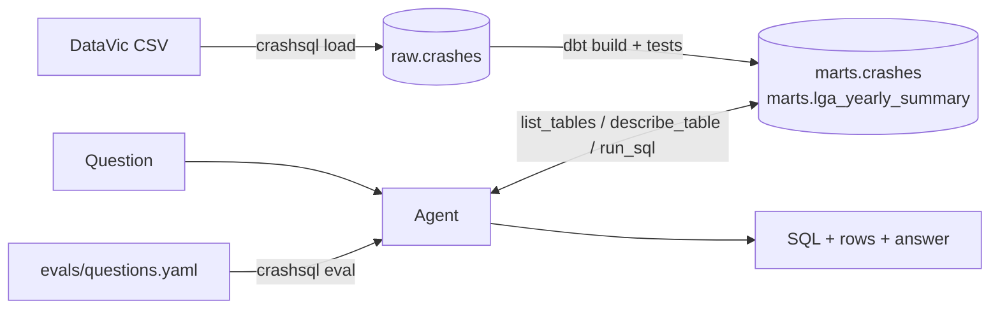

# crashsql: ask Victoria's road crash data in plain English

An LLM agent that turns a question like *"Which council had the biggest rise in crashes from
2023 to 2024?"* into SQL, runs it against a dbt-modelled DuckDB warehouse, fixes its own
mistakes, and answers in a sentence. Every answer is scored against hand-checked gold queries.

**[Try the live demo](https://llm-project-8jgwjxvnyd8kk5lj5b9xg5.streamlit.app/)** ·
**[Learning path](https://cesinata.github.io/llm-project/)** (how every part works, with the
real numbers)

- **Data:** [Victoria Road Crash Data](https://discover.data.vic.gov.au/dataset/victoria-road-crash-data),
  202,554 police-reported crashes from 2012 onwards (CC BY 4.0).
- **Stack:** Python, DuckDB, dbt, an OpenAI-compatible LLM API (Groq, Gemini, Anthropic or local
  Ollama), Streamlit, pytest, GitHub Actions.



## Quick start

```bash
python -m venv .venv && source .venv/bin/activate
pip install -e ".[dev]"

crashsql load          # downloads the 70 MB CSV and loads it into data/warehouse.duckdb
crashsql build         # dbt models + data tests

cp .env.example .env   # then add a free API key (see below)
crashsql ask -v "How many people were killed in road crashes in 2024?"
crashsql eval          # runs all questions in evals/questions.yaml
```

`crashsql load --sample` uses the bundled 1,000-row sample instead, which is what CI uses.

## Web demo

**Live:** [llm-project-8jgwjxvnyd8kk5lj5b9xg5.streamlit.app](https://llm-project-8jgwjxvnyd8kk5lj5b9xg5.streamlit.app/),
running Claude Haiku 4.5.

`streamlit_app.py` is a small web front end: example questions, a text box, and for each answer
the SQL, the result table, steps, tokens, latency and the agent's tool calls.

```bash
pip install -e ".[app]"
streamlit run streamlit_app.py
```

To protect free API limits, each visitor gets 5 new questions and the app answers at most 100
new questions a day (`DEMO_QUESTIONS_PER_SESSION`, `DEMO_QUESTIONS_PER_DAY`). Questions that were
already answered are served from a shared cache and do not count.

**Deploying on [Streamlit Community Cloud](https://share.streamlit.io) (free):** create an app
from this repo with main file `streamlit_app.py`, and under **Advanced settings → Secrets** add:

```toml
LLM_PROVIDER = "groq"
GROQ_API_KEY = "gsk_..."
LLM_MODEL = "llama-3.3-70b-versatile"
```

On first start the app downloads the crash data and runs `dbt build`, which takes about a minute.

## Choosing a model

| Provider | Setting | Free limits | Notes |
|---|---|---|---|
| [Groq](https://console.groq.com/keys) | `LLM_PROVIDER=groq`, `GROQ_API_KEY` | ~1,000 requests and 200k tokens per day | Default model `openai/gpt-oss-120b` |
| [Gemini](https://aistudio.google.com/apikey) | `LLM_PROVIDER=gemini`, `GEMINI_API_KEY` | Per-model limits shown in AI Studio | Free-tier prompts may be used by Google; fine for public data |
| [Ollama](https://ollama.com) | `LLM_PROVIDER=ollama` | Unlimited, runs locally | Default model `qwen2.5:7b` (`ollama pull qwen2.5:7b`) |
| [Anthropic](https://console.anthropic.com/settings/keys) | `LLM_PROVIDER=anthropic`, `ANTHROPIC_API_KEY` | Paid, prepaid credits | Default model `claude-haiku-4-5`; a full evaluation run costs well under US$1 |

Groq, Gemini and Ollama are free. Anthropic is the one paid option, included as a commercial
baseline.

Set `LLM_MODEL` to try another model. One question uses roughly 5k to 10k tokens, so a full
evaluation run can use a large share of Groq's daily token allowance.

## How the agent works

The agent has four tools: `list_tables`, `describe_table`, `run_sql` and `final_answer`.
`describe_table` returns the dbt column descriptions (persisted into DuckDB as comments) plus
the exact labels of every low-cardinality text column, so the model filters on
`'Struck Pedestrian'` rather than guessing `'pedestrian'`. SQL errors are returned to the
model so it can correct itself; the evaluator records how often that happens.

All database access goes through a small `Database` interface (`src/crashsql/db.py`), so adding
Snowflake or Postgres means one new class, not changes to the agent.

**Guardrails:** the agent's connection is read-only, accepts exactly one `SELECT` statement,
cannot read files or URLs (DuckDB external access is disabled and the setting locked), and
cancels queries after 20 seconds.

## Evaluation

`evals/questions.yaml` holds 22 questions: 5 easy, 8 medium, 7 hard and 2 that the data cannot
answer, where the right behaviour is to decline. Each gold query was run and checked against the
full dataset.

A prediction counts as correct when its query returns the same rows as the gold query (execution
accuracy). Column names, column order and extra columns are ignored; numbers are compared to one
decimal place; row order is checked only when the question asks for it.

`crashsql eval` writes per-question records and a summary (accuracy by difficulty, self-corrections,
steps, tokens and latency) to `evals/results/`.

### Results

| Model | Runs on | Execution accuracy | Easy (5) | Medium (8) | Hard (7) | Unanswerable (2) | Avg tokens / question | Avg seconds / question |
|---|---|---|---|---|---|---|---|---|
| `claude-haiku-4-5` | Anthropic API (paid, about US$0.30 per run) | **18/22 (82%)** | 5/5 | 6/8 | 5/7 | 2/2 | 12,324 | 7.0 |
| `qwen2.5:7b` | Ollama on a MacBook | 11/22 (50%) | 4/5 | 3/8 | 4/7 | 0/2 | 7,881 | 101.5 |
| `openai/gpt-oss-120b` | Groq free tier | **18/22 (82%)** | 5/5 | 7/8 | 5/7 | 1/2 | 10,258 | 66.3 |
| `openai/gpt-oss-20b` | Groq free tier | 17/22 (77%) | 5/5 | 6/8 | 5/7 | 1/2 | 11,138 | 74.2 |
| Gemini Flash | Google AI Studio free tier | _in progress_ | | | | | | |

With 22 questions, a score has a 95% margin of about ±20 percentage points, so treat small gaps
between models as noise. Groq's free tier allows about 200k tokens per model per day. Both Groq
runs used a bit more than that, and the blood-alcohol question was the one left unfinished:
`gpt-oss-120b` hit the daily token cap, and `gpt-oss-20b` sent a request larger than the
per-minute limit. Those two cells are provider limits, not wrong answers. Per-question records are
in `evals/results/`.

What the runs show so far:

- **The small local model over-applies instructions.** The prompt says to exclude the partial
  latest year when comparing years. `qwen2.5:7b` added that filter to 19 of its 22 queries,
  including *"How many crashes are in the dataset?"*, where it answered 202,305 instead of
  202,554.
- **Declining is harder than answering.** `qwen2.5:7b` saw that blood alcohol is not in the data
  but wrapped that reply in a `SELECT NULL ...` query, and answered the New South Wales question
  with a count of 0. Claude Haiku declined both correctly.
- **Plausible wrong columns.** On freeway crashes, `qwen2.5:7b` and `gpt-oss-20b` filtered
  `road_type = 'FREEWAY'` (108 crashes) instead of `road_class = 'Freeway'` (184). Claude Haiku
  and `gpt-oss-120b` picked the right column. On motorcycle crashes, `gpt-oss-120b` counted
  `motorcyclists` (people) instead of `motorcycles` (vehicles). The top two movements matched;
  the third was 180 crashes instead of 182.
- **The partial-year rule is easy to over-apply.** `gpt-oss-20b` dropped 2025 from "each year
  from 2015 to 2025" even though only 2026 is partial. Both Groq models excluded 2026 from the
  young-driver weekend question and got 25.7% instead of 25.8%.
- **Right numbers can still fail the check.** For fatal versus non-fatal vehicles per crash,
  `gpt-oss-120b` returned 1.6 and 1.8, which are the right averages, but labelled the groups
  "Fatal" and "Non-fatal" instead of returning the boolean `is_fatal` column. Execution accuracy
  compares values, so the labels did not match.

## Data quality findings

Found while building the gold answers, and fixed or documented in dbt:

- **A renamed council split across two names.** Moreland was renamed Merri-bek in 2022, and the
  source records both names, even within the same year. Without the fix, *"largest increase in
  crashes from 2023 to 2024"* returns Merri-bek (+152); the correct answer is Hume (+59).
  `stg_crashes` merges the names and the `no_renamed_councils` test keeps it that way.
- **The latest year is partial.** 2026 has only 249 crashes. `is_complete_year` lets trend
  questions exclude it, and the agent is told to.
- **People are not crashes.** One fatal crash can kill several people, so "fatal crashes" and
  "people killed" differ. Column descriptions spell this out for the model.
- `TOTAL_PERSONS` does not always equal injured plus uninjured (4,834 rows), so the project uses
  the specific casualty columns.

## Running the dbt models on Snowflake (optional)

The same dbt models can run on a [Snowflake trial](https://signup.snowflake.com/) (30 days, US$400
credits).

1. `pip install -e ".[snowflake]"`
2. In a Snowsight worksheet, run [`snowflake/setup.sql`](snowflake/setup.sql) step by step: it
   creates `CRASHSQL.RAW.CRASHES` (all columns as text) and a stage, you upload the CSV to the
   stage, and `copy into` loads it.
3. Set up key-pair login, since new accounts enforce MFA for passwords:

   ```bash
   openssl genrsa 2048 | openssl pkcs8 -topk8 -inform PEM -out ~/.ssh/snowflake_key.p8 -nocrypt
   openssl rsa -in ~/.ssh/snowflake_key.p8 -pubout   # paste the middle lines into step 4 of setup.sql
   ```

4. Set the connection and build:

   ```bash
   export SNOWFLAKE_ACCOUNT=<account locator>      # from `select current_account();`
   export SNOWFLAKE_HOST=<org>-<account>.snowflakecomputing.com
   export SNOWFLAKE_USER=<your user name>
   export SNOWFLAKE_PRIVATE_KEY_PATH=~/.ssh/snowflake_key.p8
   crashsql build --target snowflake
   ```

   This builds `CRASHSQL.STAGING` and `CRASHSQL.MARTS` and runs the same 11 data tests.

## Learning path

[`docs/learning/`](docs/learning/index.md) explains every method used here, from execution
accuracy to DuckDB, dbt, the agent loop and the evaluation, with the real numbers from this repo.
Chapters 1 to 3 are written; the rest are outlined. The same pages are published at
[cesinata.github.io/llm-project](https://cesinata.github.io/llm-project/). To preview them locally:

```bash
pip install -e ".[docs]"
mkdocs serve
```

## Project layout

```
src/crashsql/   agent, database layer, LLM client, evaluator, CLI
dbt/            staging and mart models, column docs, data tests
docs/           learning path (MkDocs site)
evals/          questions.yaml (gold SQL) and results/
data/sample/    1,000-row sample used by tests and CI
tests/          pytest suite (no network or API key needed)
```

## Roadmap

- [x] Web demo on Streamlit Community Cloud
- [x] Evaluate a paid model (Claude Haiku) and a local model (Qwen 2.5 7B)
- [x] Groq runs for `gpt-oss-120b` (18/22) and `gpt-oss-20b` (17/22)
- [ ] Gemini run, to finish the results table
- [ ] Fix the prompt issues found in the runs and re-evaluate (before and after)
- [ ] Finish learning chapters 4 to 10
- [ ] Score on [BIRD Mini-Dev](https://github.com/BIRD-bench/mini_dev) for a public comparison
- [ ] Run the dbt models on Snowflake

## Data attribution

Department of Transport and Planning, Victoria, *Victoria Road Crash Data*,
https://discover.data.vic.gov.au/dataset/victoria-road-crash-data, licensed under
[CC BY 4.0](https://creativecommons.org/licenses/by/4.0/). The sample in `data/sample/` is a
subset of that dataset.
