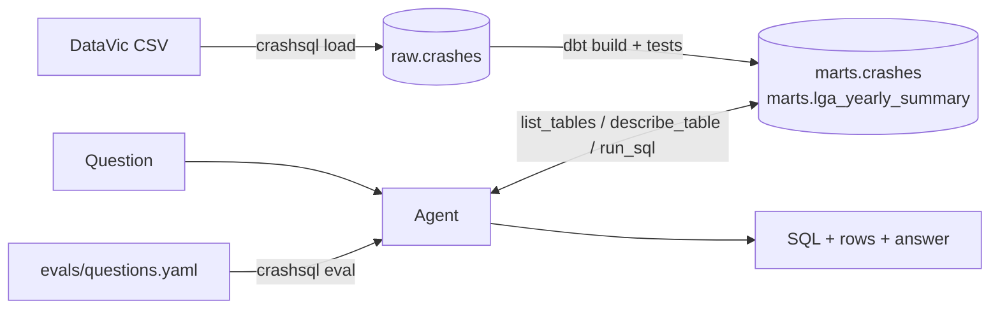

# crashsql: ask Victoria's road crash data in plain English

An LLM agent that turns a question like *"Which council had the biggest rise in crashes from
2023 to 2024?"* into SQL, runs it against a dbt-modelled DuckDB warehouse, fixes its own
mistakes, and answers in a sentence. Every answer is scored against hand-checked gold queries.

- **Data:** [Victoria Road Crash Data](https://discover.data.vic.gov.au/dataset/victoria-road-crash-data),
  202,554 police-reported crashes from 2012 onwards (CC BY 4.0).
- **Stack:** Python, DuckDB, dbt, an OpenAI-compatible LLM API (Groq, Gemini, Anthropic or local Ollama),
  pytest, GitHub Actions.



## Quick start

```bash
python -m venv .venv && source .venv/bin/activate
pip install -e ".[dev]"

crashsql load          # downloads the 70 MB CSV and loads it into data/warehouse.duckdb
crashsql build         # dbt models + data tests

cp .env.example .env   # then add a free API key (see below)
crashsql ask -v "How many people were killed in road crashes in 2024?"
crashsql eval          # runs all questions in evals/questions.yaml
```

`crashsql load --sample` uses the bundled 1,000-row sample instead, which is what CI uses.

## Choosing a model

| Provider | Setting | Free limits | Notes |
|---|---|---|---|
| [Groq](https://console.groq.com/keys) | `LLM_PROVIDER=groq`, `GROQ_API_KEY` | ~1,000 requests and 200k tokens per day | Default model `openai/gpt-oss-120b` |
| [Gemini](https://aistudio.google.com/apikey) | `LLM_PROVIDER=gemini`, `GEMINI_API_KEY` | Per-model limits shown in AI Studio | Free-tier prompts may be used by Google; fine for public data |
| [Ollama](https://ollama.com) | `LLM_PROVIDER=ollama` | Unlimited, runs locally | Default model `qwen2.5:7b` (`ollama pull qwen2.5:7b`) |
| [Anthropic](https://console.anthropic.com/settings/keys) | `LLM_PROVIDER=anthropic`, `ANTHROPIC_API_KEY` | Paid, prepaid credits | Default model `claude-haiku-4-5`; a full evaluation run costs well under US$1 |

Groq, Gemini and Ollama are free. Anthropic is the one paid option, included as a commercial
baseline.

Set `LLM_MODEL` to try another model. One question uses roughly 5k to 10k tokens, so a full
evaluation run can use a large share of Groq's daily token allowance.

## How the agent works

The agent has four tools: `list_tables`, `describe_table`, `run_sql` and `final_answer`.
`describe_table` returns the dbt column descriptions (persisted into DuckDB as comments) plus
the exact labels of every low-cardinality text column, so the model filters on
`'Struck Pedestrian'` rather than guessing `'pedestrian'`. SQL errors are returned to the
model so it can correct itself; the evaluator records how often that happens.

All database access goes through a small `Database` interface (`src/crashsql/db.py`), so adding
Snowflake or Postgres means one new class, not changes to the agent.

**Guardrails:** the agent's connection is read-only, accepts exactly one `SELECT` statement,
cannot read files or URLs (DuckDB external access is disabled and the setting locked), and
cancels queries after 20 seconds.

## Evaluation

`evals/questions.yaml` holds 22 questions: 5 easy, 8 medium, 7 hard and 2 that the data cannot
answer, where the right behaviour is to decline. Each gold query was run and checked against the
full dataset.

A prediction counts as correct when its query returns the same rows as the gold query (execution
accuracy). Column names, column order and extra columns are ignored; numbers are compared to one
decimal place; row order is checked only when the question asks for it.

`crashsql eval` writes per-question records and a summary (accuracy by difficulty, self-corrections,
steps, tokens and latency) to `evals/results/`.

### Results

| Model | Execution accuracy | Easy | Medium | Hard | Unanswerable | Avg tokens / question |
|---|---|---|---|---|---|---|
| _not run yet_ | | | | | | |

## Data quality findings

Found while building the gold answers, and fixed or documented in dbt:

- **A renamed council split across two names.** Moreland was renamed Merri-bek in 2022, and the
  source records both names, even within the same year. Without the fix, *"largest increase in
  crashes from 2023 to 2024"* returns Merri-bek (+152); the correct answer is Hume (+59).
  `stg_crashes` merges the names and the `no_renamed_councils` test keeps it that way.
- **The latest year is partial.** 2026 has only 249 crashes. `is_complete_year` lets trend
  questions exclude it, and the agent is told to.
- **People are not crashes.** One fatal crash can kill several people, so "fatal crashes" and
  "people killed" differ. Column descriptions spell this out for the model.
- `TOTAL_PERSONS` does not always equal injured plus uninjured (4,834 rows), so the project uses
  the specific casualty columns.

## Running the dbt models on Snowflake (optional)

The same dbt models can run on a [Snowflake trial](https://signup.snowflake.com/) (30 days, US$400
credits). This has not been tested yet.

1. `pip install -e ".[snowflake]"`
2. In Snowsight, create database `CRASHSQL` and schema `RAW`, then load the CSV into a table
   `RAW.CRASHES` with all columns as `VARCHAR`.
3. Set `SNOWFLAKE_ACCOUNT`, `SNOWFLAKE_USER` and `SNOWFLAKE_PASSWORD`, then run
   `crashsql build --target snowflake`.

## Project layout

```
src/crashsql/   agent, database layer, LLM client, evaluator, CLI
dbt/            staging and mart models, column docs, data tests
evals/          questions.yaml (gold SQL) and results/
data/sample/    1,000-row sample used by tests and CI
tests/          pytest suite (no network or API key needed)
```

## Roadmap

- [ ] Run the full evaluation with two or three models and fill in the results table
- [ ] Score on [BIRD Mini-Dev](https://github.com/BIRD-bench/mini_dev) for a public comparison
- [ ] TypeScript web front end with an API, deployed on AWS
- [ ] Run the dbt models on Snowflake

## Data attribution

Department of Transport and Planning, Victoria, *Victoria Road Crash Data*,
https://discover.data.vic.gov.au/dataset/victoria-road-crash-data, licensed under
[CC BY 4.0](https://creativecommons.org/licenses/by/4.0/). The sample in `data/sample/` is a
subset of that dataset.
