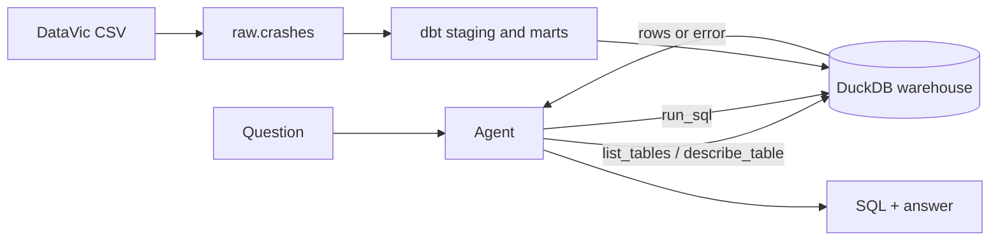

# crashsql

An LLM agent that answers plain-English questions about Victoria's road crash data by writing SQL, running it against a dbt-modelled DuckDB warehouse, fixing its own mistakes, and answering in a sentence. Every answer is scored against hand-checked gold queries.

- **Code:** [github.com/cesinata/llm-project](https://github.com/cesinata/llm-project)
- **Live demo:** [ask the data a question](https://llm-project-8jgwjxvnyd8kk5lj5b9xg5.streamlit.app/)
- **Data:** [Victoria Road Crash Data](https://discover.data.vic.gov.au/dataset/victoria-road-crash-data), 202,554 police-reported crashes from 1 January 2012 to 28 March 2026 (CC BY 4.0)

## Learning path

The [learning path](learning/index.md) explains every method and tool used here, from the metric to the warehouse to the agent loop, with the real numbers from this repo.

| # | Chapter |
|---|---|
| 1 | [Text-to-SQL and execution accuracy](learning/01_text_to_sql_and_execution_accuracy.md) |
| 2 | [DuckDB and columnar analytics](learning/02_duckdb_and_columnar_analytics.md) |
| 3 | [dbt models, tests and docs](learning/03_dbt_models_tests_and_docs.md) |
| 4 | [Schema linking](learning/04_schema_linking.md) |
| 5 | [Tool calling and the agent loop](learning/05_tool_calling_and_the_agent_loop.md) |
| 6 | [SQL guardrails](learning/06_sql_guardrails.md) |
| 7 | [Designing the evaluation](learning/07_designing_the_evaluation.md) |
| 8 | [Comparing models](learning/08_comparing_models.md) |
| 9 | [Error analysis](learning/09_error_analysis.md) |
| 10 | [Testing LLM code](learning/10_testing_llm_code.md) |
| + | [Optional: Snowflake as a second warehouse](learning/X1_optional_snowflake.md) |
