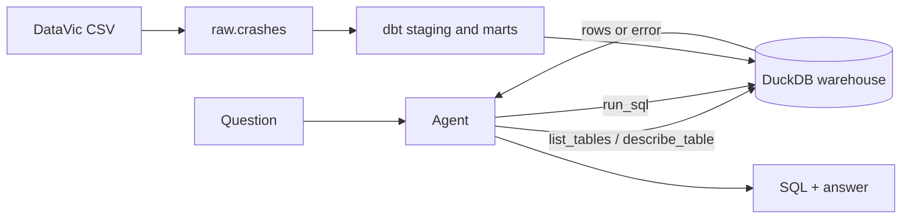

# crashsql

An LLM agent that answers plain-English questions about Victoria's road crash data by writing SQL, running it against a dbt-modelled DuckDB warehouse, fixing its own mistakes, and answering in a sentence. Every answer is scored against hand-checked gold queries.

- **Code:** [github.com/cesinata/llm-project](https://github.com/cesinata/llm-project)
- **Live demo:** coming soon
- **Data:** [Victoria Road Crash Data](https://discover.data.vic.gov.au/dataset/victoria-road-crash-data), 202,554 police-reported crashes from 1 January 2012 to 28 March 2026 (CC BY 4.0)

## Learning path

The [learning path](learning/index.md) explains every method and tool used here, from the metric to the warehouse to the agent loop, with the real numbers from this repo. It is written for two readers: me, to make sure I understand every part, and anyone reviewing the project who wants to see why it was built this way.

| # | Chapter | Status |
|---|---|---|
| 1 | [Text-to-SQL and execution accuracy](learning/01_text_to_sql_and_execution_accuracy.md) | Written |
| 2 | [DuckDB and columnar analytics](learning/02_duckdb_and_columnar_analytics.md) | Written |
| 3 | [dbt models, tests and docs](learning/03_dbt_models_tests_and_docs.md) | Written |
| 4-10 | Schema linking, tool calling, guardrails, evaluation design, model comparison, error analysis, testing | Coming soon |
| + | Optional: Snowflake as a second warehouse | Coming soon |
